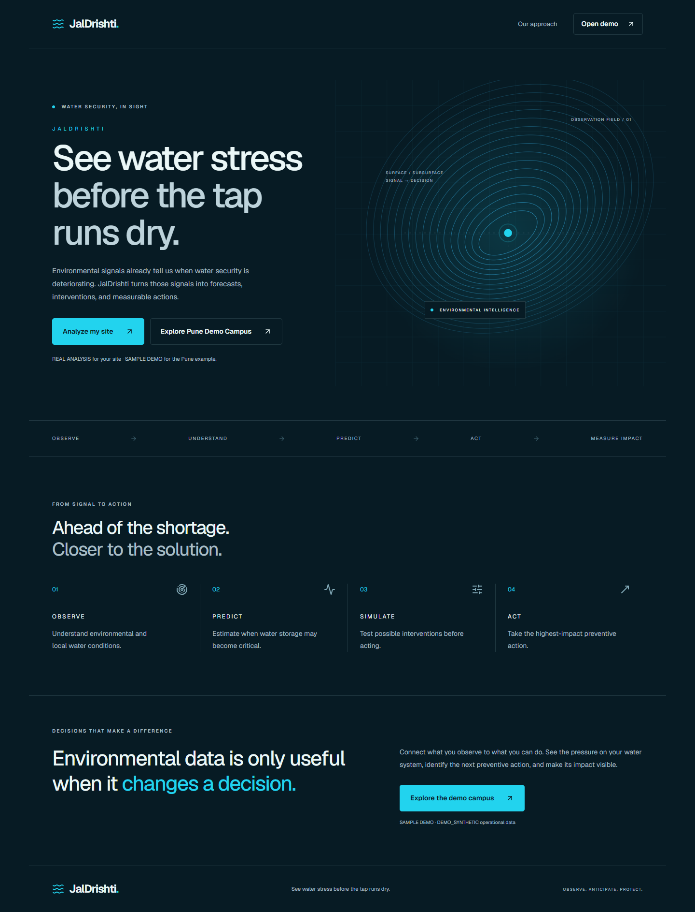
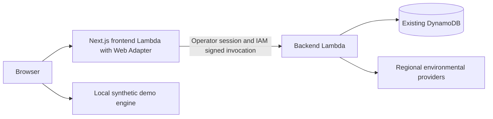
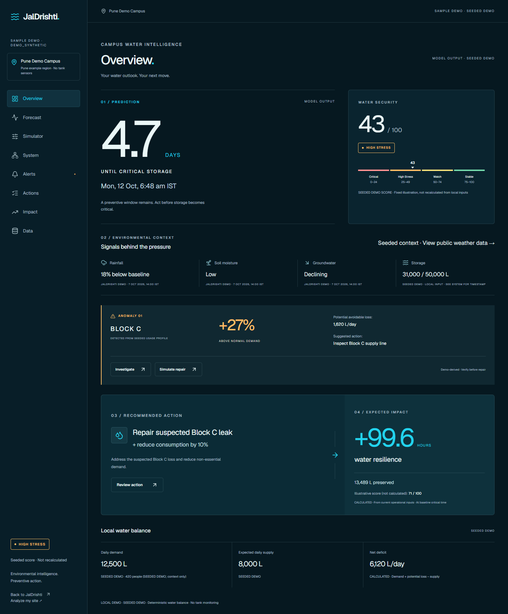
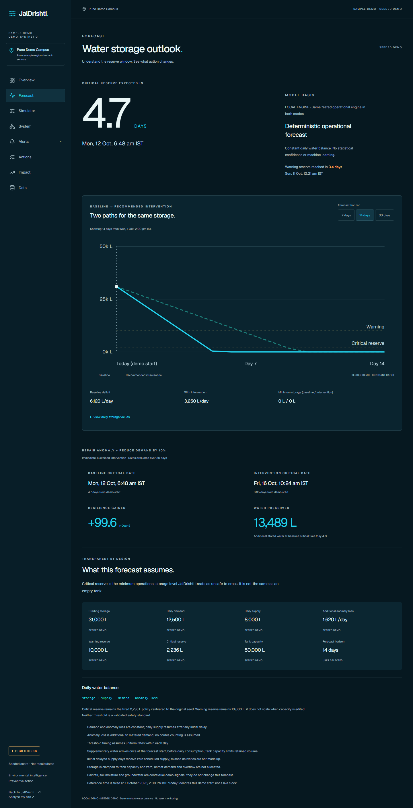
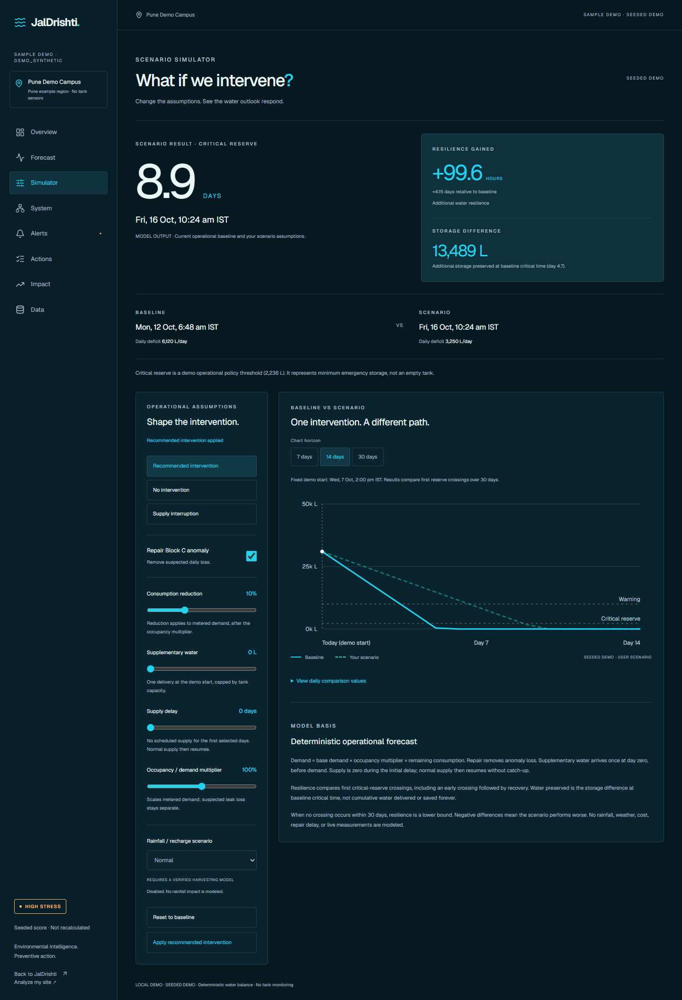
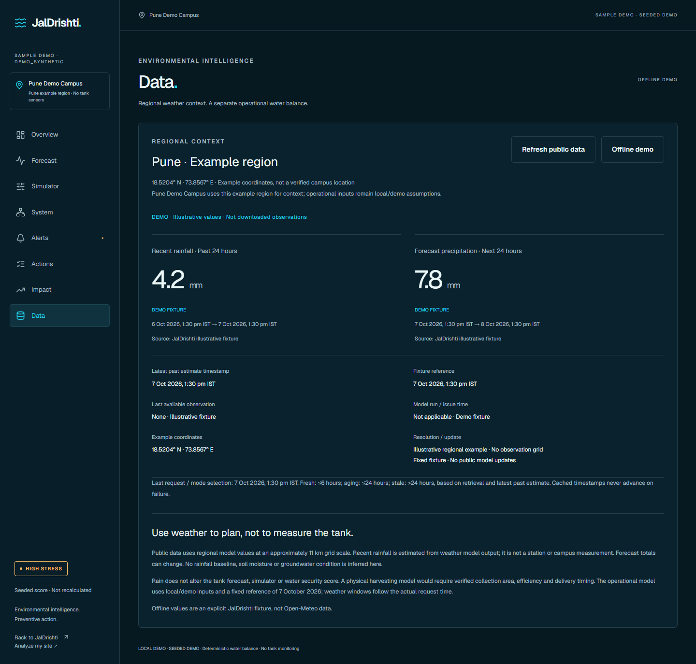

# JalDrishti

**Water security, in sight.** Understand a site's water balance, compare practical interventions, and distinguish regional environmental context from local storage.

[Live demo](https://oesv4kceg4gzmoozx7x7adnwwm0tirfq.lambda-url.ap-southeast-2.on.aws/) · [Demo guide](docs/submission/DEMO-GUIDE.md) · [Architecture](docs/submission/ARCHITECTURE.md) · [Project summary](docs/submission/PROJECT-SUMMARY.md)



## The problem

Institutions and communities need to understand how storage, consumption and unreliable supply interact before reserves are exhausted. Regional weather adds context, but cannot measure an individual tank. Decisions need traceable inputs and explicit assumptions rather than an unexplained risk number.

## Implemented features

- Overview, editable System inputs, 7/14/30-day Forecast charts and Scenario Simulator.
- Compare demand reduction, supplementary water, supply delays, demand multipliers and repair of explicitly assumed additional loss.
- Empty-start Real Analysis with user-provided readings, validated CSV records, demand baselines, reserve policies and per-field provenance.
- Median/MAD zone anomaly flags and a versioned decision-support index with inspectable contributions and missing-data handling.
- Open-Meteo regional model/reanalysis ingestion, normalization, timestamps, freshness, caching and explicit unavailable states.
- Operator-only schema-v2 cloud save/load, revision conflicts and shared-engine backend forecasts.
- Responsive public Sample Demo with local calculations and no AWS storage calls.

[Feature matrix and exclusions](docs/submission/FEATURES.md)

## Sample Demo and Real Analysis

| Workspace | Inputs | Persistence and access |
| --- | --- | --- |
| Sample Demo, `/dashboard` | Labeled synthetic Pune example and fixed reference dates | Anonymous; edits/scenarios stay in browser memory and reset on reload |
| Real Analysis, `/analysis` | Explicit user/imported inputs; DEMO_SYNTHETIC rejected | Local calculation; hosted cloud persistence and environmental requests require the operator session |

Public Sample Demo Data starts with offline fixtures, not downloaded observations. Hosted live environmental context requires operator access. No operator code is included in the repository or needed to explore the sample.

## Forecasts and scenarios

The shared deterministic engine advances storage by supply minus demand minus explicitly entered additional loss, bounded between zero and capacity. It estimates first warning/critical reserve crossings under those assumptions. The simulator transforms the same inputs and compares trajectories; it is not a separate prediction model.

Supplementary water arrives once at the starting time, capped by capacity. Delayed supply resumes without making up missed deliveries. Rainfall does not enter tank storage because no verified catchment/capture model exists. Demo reserves and dates are illustrative; real reserves/readings are explicit. No validated accuracy, statistical confidence, confirmed leak detection or measured water savings is claimed.

[Forecast assumptions](src/features/forecast/ASSUMPTIONS.md) · [Simulator assumptions](src/features/simulator/ASSUMPTIONS.md) · [Real Analysis methods](src/features/analysis/README.md)

## Environmental data and provenance

Open-Meteo/DWD ICON provides fixed-region recent rainfall estimates and precipitation forecasts. Real Analysis uses selected coordinates with ECMWF modeled variables and delayed ERA5 historical comparisons. These grids describe a region, not a building, tank or well. Three comparison years are not a climatological normal.

Sources, units, grid/requested location, valid/retrieval times and unavailable/stale states are retained. Missing data does not silently become synthetic. NASA POWER and NASA SMAP were evaluated, not integrated. Groundwater supports source-qualified user import; there is no automatic CGWB ingestion or satellite tank measurement. Open-Meteo attribution and service terms apply.

[Detailed sources](src/features/environment/SOURCES.md) · [Open-Meteo](https://open-meteo.com/en/docs) · [Historical weather](https://open-meteo.com/en/docs/historical-weather-api)

## AWS architecture



The public HTTPS Function URL delivers the frontend. Protected Next.js handlers require an operator session and exact mutation origin; the execution role invokes only the existing backend function. Backend IAM is independent of CORS, with an additional token gate for Real Analysis. The retained IAM-protected HTTP API is a legacy entry point, not the frontend persistence transport. No WAF, CloudFront, VPC/NAT or additional database is used.

Production is frontend version 5 in Sydney. Repository preparation does not redeploy it. [Architecture and security](docs/submission/ARCHITECTURE.md)

## Technologies

Next.js 16.4, React 19.3, TypeScript 6, Node.js 24, Tailwind CSS 4, SVG charts, Lucide icons, Geist typography, Lambda Web Adapter, SigV4 and DynamoDB. Dependencies are pinned in both lockfiles. Tests use Node's built-in runner; no large SDK, browser download or global deployment tool is required for local exploration.

## Safe local setup

Use an existing Node.js 24 installation and npm. On this Windows workspace keep the checkout, dependencies, caches and outputs under `A:\Projects\JalDrishti`. Do not clone over an existing directory. Cloud credentials are unnecessary for Sample Demo.

```powershell
Set-Location A:\Projects\JalDrishti
New-Item -ItemType Directory -Force .cache\tmp | Out-Null
$env:TEMP = "$PWD\.cache\tmp"
$env:TMP = $env:TEMP
$env:npm_config_cache = "$PWD\.npm-cache"
$env:NEXT_TELEMETRY_DISABLED = '1'
npm ci --no-audit --no-fund
npm ci --prefix infra --no-audit --no-fund
npm run dev
```

Open `http://127.0.0.1:3000`. For an existing Linux checkout use equivalent project-local cache/temp paths. Lambda packaging requires Linux x86_64 Node 24; Windows output is not an approved AWS release. Do not install a Linux environment or deploy AWS just to try the demo.

Sample Demo needs no `.env`. `.env.example` contains blank placeholders only. Server-side configuration names:

| Name | Purpose |
| --- | --- |
| JALDRISHTI_ACCESS_CODE | Operator unlock secret |
| JALDRISHTI_SESSION_SECRET | Session signature secret |
| JALDRISHTI_BACKEND_TOKEN | Additional backend gate |
| JALDRISHTI_FRONTEND_ORIGIN | Exact trusted frontend origin |
| JALDRISHTI_BACKEND_FUNCTION_NAME | Fixed backend destination |
| AWS_REGION | Backend invocation region |
| AWS_ACCOUNT_ID | Optional review-template substitution |
| CAMPUS_TABLE_NAME | Backend table binding |

Lambda supplies temporary execution-role credentials. Never put credentials or operator secrets in NEXT_PUBLIC variables, builds, Git, screenshots or ZIPs. Private values belong only in ignored configuration or trusted runtime configuration; this guide supplies none.

## Development and tests

```powershell
npm test
npm run lint
npx --no-install next typegen
npm run typecheck
```

The full suite needs root and `infra` dependencies. Existing validation includes **163 passing tests** and **44 responsive checks** during public launch; these counts describe tested cases, not scientific accuracy. Automated tests mock external APIs. Optional local production preview:

```powershell
npm run build
npm start
```

The safe-build wrapper excludes local secrets from standalone output. Git excludes dependencies, caches, private reports, ZIPs and operational helpers. [Infrastructure reference](infra/README.md)

## Security and limitations

Operator cookies are HttpOnly, Secure on hosted HTTPS and SameSite=Strict. Protected endpoints validate session, mutation origin, payload size, schema and provenance. Real/demo records use independent keys and conditional revision writes. Backend failures are sanitized; provider failure does not disable the local engine.

This is a single-operator demo, not multi-tenant authentication. Process-local throttling/cache is not global protection or a financial cap. Public requests incur Lambda usage and share a small concurrency pool. There is no IoT telemetry, calibrated leak diagnosis, ML model, validated drought score or full geospatial forecast. The custom index is an engineering heuristic, not an official standard. Alerts, Actions and Impact are placeholders. No license for original project source has been selected; dependency/data licenses remain their own.

## Actual screenshots

Existing anonymous public-browser captures, not generated mockups. Displayed values are synthetic; screenshot pixels are unchanged.






## Hackathon submission

Prepared for **WeMakeDevs + AWS Environmental Hacks 2026**. See the [official event](https://www.wemakedevs.org/aws/env) and [rules](https://www.wemakedevs.org/aws/env/rules). Participation, enrollment verification, eligibility and permitted development history must be checked by the submitter. This README does not assert compliance or invent development dates or awards.
