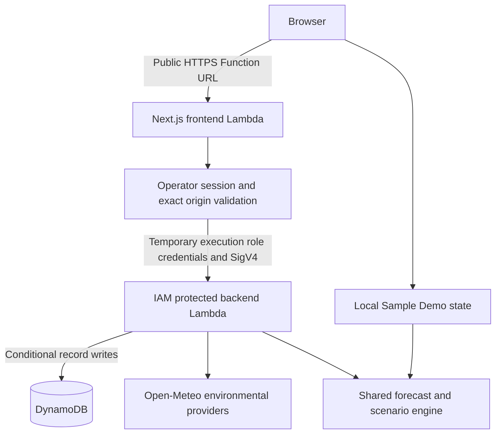

# Architecture

[Home](../../README.md) · [Features](FEATURES.md) · [Demo guide](DEMO-GUIDE.md)

The deployed application uses two Lambdas and the existing DynamoDB table in Sydney. The frontend is Next.js 16.4 standalone on Node 24 x86_64, with Lambda Web Adapter layer version 30, handler `run.sh`, `/opt/bootstrap`, port 8080 and readiness `/`. Static assets are inside the Linux ZIP; there is no CDN or separate asset bucket in the frontend delivery path.

## Two separate modes

Sample Demo mounts the operational provider with synthetic fixtures. Its default cloud client is disconnected. Input edits and scenario changes live in browser memory; reload resets them. Anonymous exploration does not invoke privileged backend or weather APIs. Data starts in explicitly attributed offline mode.

Real Analysis starts empty and never mounts that provider. User/imported values carry provenance and are validated before calculation or persistence. Local calculations can run without cloud access; hosted cloud operations require the signed operator session. DEMO_SYNTHETIC is rejected recursively in the real decision path.

## Trust boundaries

The public frontend URL uses AuthType NONE, with public permissions restricted to the `live` alias and invocation through its URL. This does not make backend storage public. Every protected read/write checks the operator session. Mutations also enforce the exact configured origin, body limits and schema. Cookies are HttpOnly, Secure on HTTPS, SameSite=Strict and scoped to `/api`.

The frontend role can invoke only the existing backend function and write its own logs. It has no direct DynamoDB or administrator permissions. Backend invocation requires IAM; Real Analysis adds a server-side token gate. The frontend uses temporary role credentials and SigV4. CORS is not authorization. The retained HTTP API's four routes are IAM-protected and not used by the current frontend persistence transport.

Three operator secrets are loaded at runtime from encrypted Lambda configuration. Bootstrap validates them; build-safe tooling excludes local env files and secret-bearing variables. No browser AWS credentials or secret store service is added. Exceptions become sanitized unavailable states.

## Persistence and engine

DynamoDB uses independent demo schema-1 and real schema-2 keys. Real state includes accepted operational records, reserve policy, original provenance, revision/model metadata and server-derived environmental provenance. Reads are consistent; writes conditionally check expected revision, preventing lost updates. A missing real record remains missing instead of becoming demo data.

Both browser and backend use the same forecast engine and scenario adapter. Environmental weather/model data cannot change tank storage without a justified harvesting model. Provider failures preserve operational calculation and explicit unavailable/cached metadata. Raw CSV, rejected rows and unsaved scenario controls are session-local.

## Infrastructure references

[Backend template](../../infra/template.json) retains the original API/table foundation; [frontend template](../../infra/frontend/template.json) is a private-first preparation scaffold with placeholder code, not a deployable full Next.js release. It must not be mistaken for the current public release or an invitation to deploy into the maintainer's account. [Infrastructure notes](../../infra/README.md)

There is no WAF, CloudFront, VPC/NAT, CodeBuild or extra database in the application path. Existing legacy infrastructure is not silently deleted. Public delivery incurs Lambda usage, and operator/backend work shares regional concurrency. Process-local rate limiting is not a perimeter firewall or spending cap.
